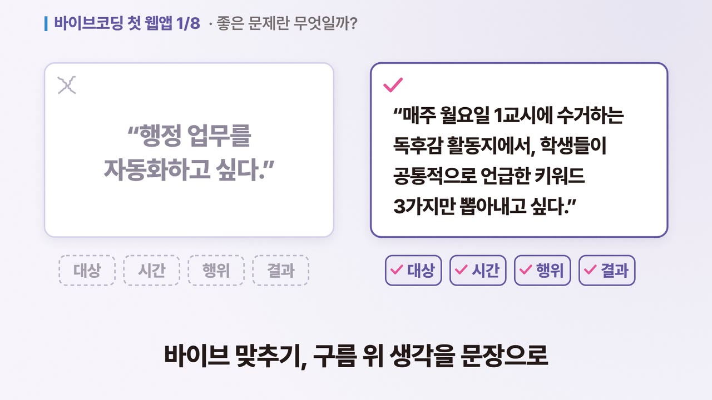
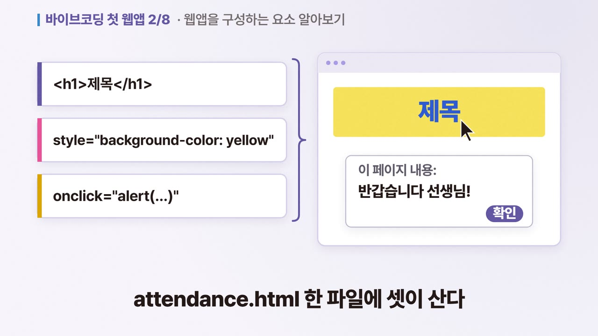
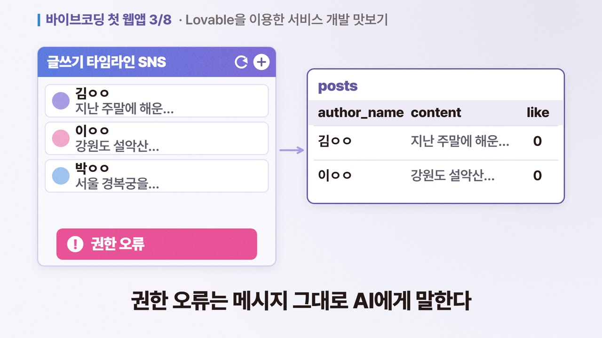
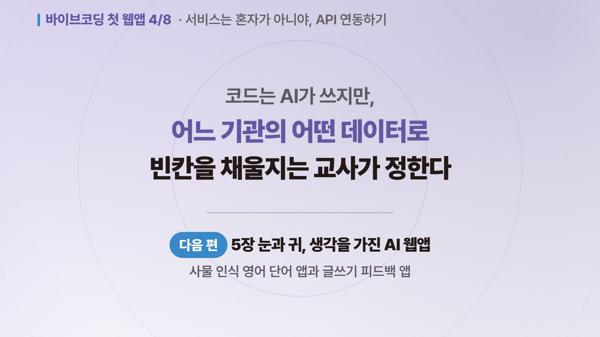
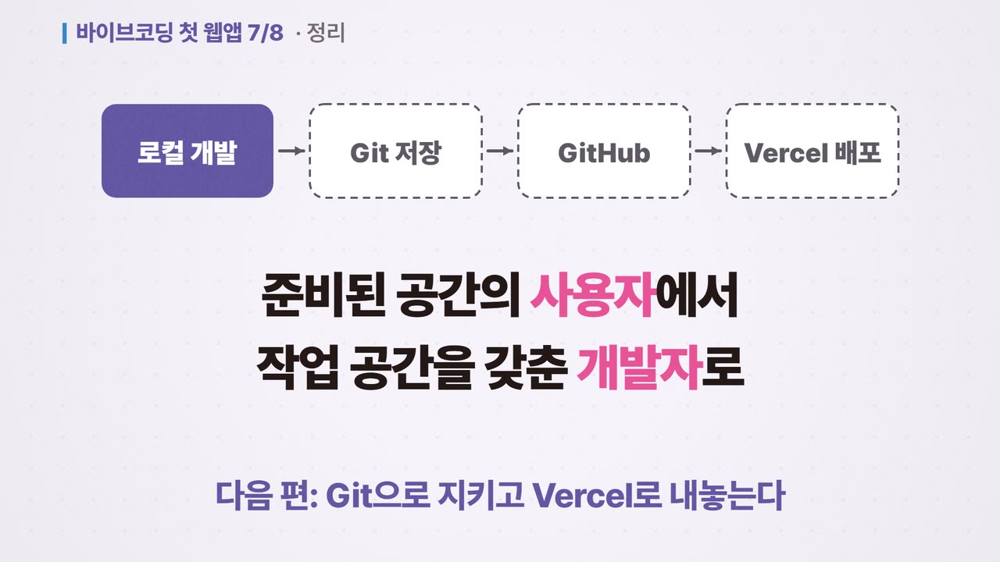
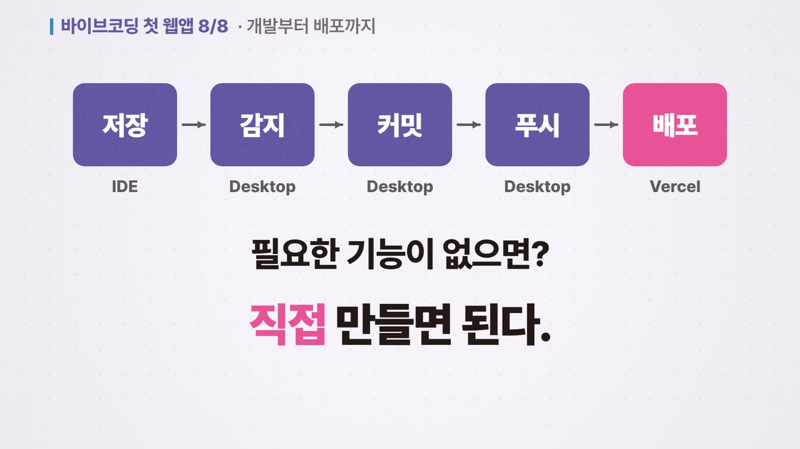

# 요즘 교사를 위한 웹앱 만들기 with 바이브 코딩 — 강의 자료

강의 참석자용 자료 페이지입니다. → **https://tigerjk9.github.io/vibecoding-lecture/**

발표자는 프로젝터로 덱을 띄우고, 참석자는 QR을 찍어 자기 폰에서 같은 자료를 봅니다.
강의가 끝난 뒤에도 같은 주소로 다시 들어올 수 있습니다.

- 강의 슬라이드 85장 (Part 1–4 + 부록) — 눌러서 확대, 좌우로 넘기기
- 장별 영상 8편 (합계 21분) — 소리 없이 자막으로 따라가기
- 파트별 PDF 6종 내려받기
- `Q` 키를 누르면 QR이 전체화면으로 — 강의장 프로젝터에 띄우는 용도

## 장별 영상 8편

책 8개 장마다 한 편씩, 소리 없이 자막으로 따라가는 요약 영상입니다(한 편 1분 반~4분, 모두 21분).
포스터를 누르면 자료 페이지의 그 영상으로 갑니다.

| 편 | 영상 | 내용 |
|---|---|---|
| 1편 · 1장 (1:38) | [](https://tigerjk9.github.io/vibecoding-lecture/#video-ch1) | **모든 아이디어는 교실에서 시작된다**<br>서술형 답안지 200장의 막막함에서 출발해 좋은 문제의 조건, ADDIE, 현상과 이면을 거쳐 PRD 한 장으로 정리합니다.<br>[MP4 받기](assets/video/vibe-ch1-720p.mp4) |
| 2편 · 2장 (1:54) | [](https://tigerjk9.github.io/vibecoding-lecture/#video-ch2) | **브라우저에서 동작하는 나의 첫 프로그램**<br>프롬프트 하나로 HTML 파일 하나짜리 출석 체크 앱을 열고, HTML·CSS·JavaScript와 로컬 스토리지가 각각 무슨 일을 하는지 봅니다.<br>[MP4 받기](assets/video/vibe-ch2-720p.mp4) |
| 3편 · 3장 (2:26) | [](https://tigerjk9.github.io/vibecoding-lecture/#video-ch3) | **AI와 함께 만드는 첫 웹 서비스, Lovable**<br>Lovable과 클라우드 DB로 글쓰기 타임라인 SNS를 만들어 주소로 배포하고, 식당 그림으로 프론트엔드·백엔드·API·DB를 나눠 봅니다.<br>[MP4 받기](assets/video/vibe-ch3-720p.mp4) |
| 4편 · 4장 (2:48) | [](https://tigerjk9.github.io/vibecoding-lecture/#video-ch4) | **서비스는 혼자가 아니야, API 연동하기**<br>구글 AI Studio에서 앱을 리믹스하고, API와 JSON을 읽은 뒤 나이스 인증 키로 급식 조회 앱을 완성합니다.<br>[MP4 받기](assets/video/vibe-ch4-720p.mp4) |
| 5편 · 5장 (2:26) | [](https://tigerjk9.github.io/vibecoding-lecture/#video-ch5) | **눈과 귀, 생각을 가진 AI 웹앱**<br>카메라로 사물을 알아보는 영어 학습 앱과 손글씨를 읽어 피드백하는 글쓰기 튜터를 만들고, 배포 전 키·요금·개인정보 유의점을 짚습니다.<br>[MP4 받기](assets/video/vibe-ch5-720p.mp4) |
| 6편 · 6장 (3:06) | [](https://tigerjk9.github.io/vibecoding-lecture/#video-ch6) | **왜 데이터베이스가 필요할까요?**<br>CRUD와 BaaS 비교에서 시작해 Supabase로 To-Do 앱을 만들고, RLS와 로그인으로 허용된 사람만 데이터를 보게 잠급니다.<br>[MP4 받기](assets/video/vibe-ch6-720p.mp4) |
| 7편 · 7장 (4:10) | [](https://tigerjk9.github.io/vibecoding-lecture/#video-ch7) | **내 컴퓨터를 React 개발 서버로 만들기**<br>Antigravity IDE 설치부터 Node.js·Vite 개발 서버, 핫 리로드, MCP로 만드는 실시간 칭찬 보드, .env와 RLS까지 따라갑니다.<br>[MP4 받기](assets/video/vibe-ch7-720p.mp4) |
| 8편 · 8장 (2:38) | [](https://tigerjk9.github.io/vibecoding-lecture/#video-ch8) | **개발부터 배포까지, 내 손으로 완성하기**<br>GitHub Desktop으로 커밋·푸시·되돌리기를 익히고, Vercel에 연결해 푸시 한 번에 다시 배포되는 흐름을 봅니다.<br>[MP4 받기](assets/video/vibe-ch8-720p.mp4) |

## 교재

**요즘 교사를 위한 웹앱 만들기 with 바이브 코딩**
이상선·김진관·이대형·윤신영·김상섭 지음 · 한빛미디어 · 2026 · ISBN 9791175790872

## 이 폴더는 생성물입니다

직접 고치지 마세요. 원본은 `ppt-automation` 저장소에 있습니다.

```bash
node .agent/workflows/skills/pptx/scripts/build_lecture_site.js workspace/vibecoding-guide
```

내용은 `workspace/vibecoding-guide/lecture.config.json` 하나가 정합니다.
일시·장소를 채우거나 다른 강의로 바꾸는 법은 `.agent/workflows/skills/pptx/docs/lecture_site.md`에 있습니다.

## 저작권

슬라이드는 『요즘 교사를 위한 웹앱 만들기 with 바이브 코딩』(한빛미디어, 2026)을 바탕으로 만든
강의용 자료입니다. 강의 참석자의 학습 목적으로만 사용해 주세요.
표지 이미지의 권리는 한빛미디어에 있습니다.
